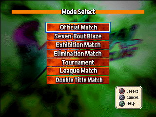
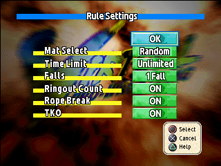
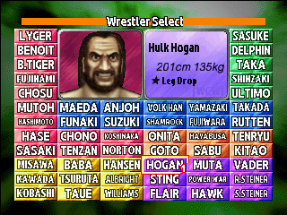
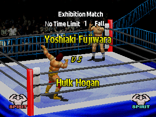
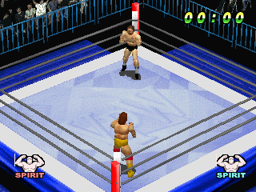
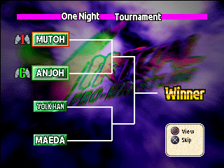
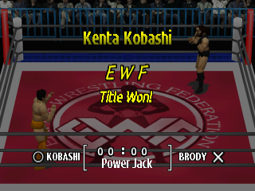

# Screenshots

Virtual Pro Wrestling with the English patch (real-names variant), taken in DuckStation.

## Mode Select

Seven modes, all menu buttons and the button legend redrawn in English.

## Options

Rule Settings: time limit, falls, mat and the rest, with a help box on Triangle.

## Wrestler Select

Redrawn name tiles and bio boxes (name, height, weight, signature move, promotion) for all 60 wrestlers.

## Intro card

Match type, rules and both wrestlers' names on the pre-match card.

## Match

In-match display, banners and the pause menu are translated too.

## Tournament

Tournament, League and Elimination screens, with the champion lines and "Winner" markers.

## Title Won

Belt screens, the Memory Card prompts and the belt-record screens.
